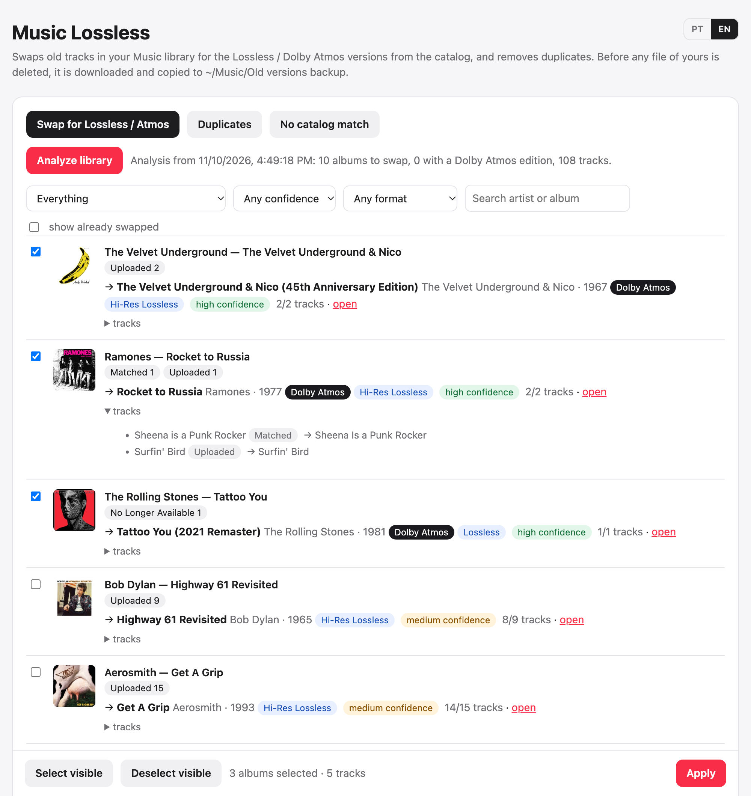

# Music Lossless

**Upgrade your Apple Music library on the Mac to Lossless and Dolby Atmos, and clean up duplicates without losing play counts or playlists.**

[Português](README.pt-BR.md)



> **Before you start:** you need an **Apple Developer account** (paid) to create a MusicKit key. The Apple Music API needs one even for personal use, and there's no way around it. Everything else is free and runs locally on your Mac.

Songs you uploaded or matched years ago with iTunes Match / Sync Library never play in Lossless or Dolby Atmos, even when the same album is in the Apple Music catalog. Apple Music has no "replace with catalog version" button, and doing it by hand loses play counts, ratings, favorites and playlist positions.

Music Lossless is a small local tool (one Python file and one web page) that does it for you:

- **Swap for Lossless / Atmos.** Finds every *Uploaded*, *Matched* or *No Longer Available* track, looks up the same album in the Apple Music catalog, adds the catalog version and replaces the old one. It also finds Apple Music albums in your library that have no Dolby Atmos when another edition of the same album does.
- **Delete albums with no catalog match.** Albums the analysis could not find in the catalog are listed in their own tab, with their tracks. Nothing is selected; the ones you pick are backed up and then deleted from the library and iCloud.
- **Remove duplicates.** Same title, artist and album, with lengths within 3 seconds. The best-quality copy stays: a lossless file on the Mac first, then Apple Music, then Purchased, then Matched, then Uploaded, then the highest bitrate.

Every replacement, whether from the catalog or from a duplicate:

1. **Backs up your own files first.** Uploaded and matched tracks are downloaded and copied to `~/Music/Old versions backup/Artist/Album/` (`Backup versões antigas` in Portuguese; whichever folder already exists is kept). If a download fails, that track is not deleted. You can turn this off with the checkbox in the backup card: your own files then leave the library and iCloud with no copy, and the confirmation dialogs say so.
2. **Moves your data to the track that stays:** play count (added up), last played date, star rating, favorite and dislike.
3. **Keeps your playlists.** In every regular playlist the new track is added at the end and the old one removed. Rebuilding playlists to keep exact positions made iCloud merge versions and duplicate whole playlists, so the tool makes the smallest possible change. The previous order is saved to `dados/playlists_antes/` first. Playlists you mark under **Playlists the script leaves alone** are never edited: the old track still disappears with the library, and the new one goes to an on-page list for you to add by hand. **Add to playlist** puts that list into a playlist of your choice (or a new "New for …" playlist), so you can select them all in the Music app and drag them into the protected playlist in one go. Use it for a playlist that iCloud keeps duplicating.
4. Deletes the old track from the library, and from iCloud.
5. Records everything in `dados/registro.jsonl`.

Tracks are identified by their **persistent ID**. The Music app's database ID can be renumbered overnight, so it is never used. Before touching a track, the tool also checks that it is still the one the analysis saw.

Nothing changes until you review the list and click **Apply**. Pre-selected items are only the high-confidence ones: every track matched, and the album and artist agree.

> The interface is available in **English** and **Brazilian Portuguese**. It follows your browser language, and the **EN / PT** switch in the top-right corner changes it. The progress log follows the same setting.

## Requirements

- macOS with the **Music** app and an active **Apple Music** subscription with **Sync Library** turned on.
- Python 3.9 or later. The one that comes with Xcode Command Line Tools works, and the tool uses only the standard library.
- `openssl`, which comes with macOS.
- An **Apple Developer** account, to create a MusicKit key. The Apple Music API needs one, even for personal use.

## Setup

### 1. Create a Media ID

In [Certificates, Identifiers & Profiles › Identifiers](https://developer.apple.com/account/resources/identifiers/list), click **+**, choose **Media IDs**, then fill in:

- **Description:** anything, for example `Music Lossless`.
- **Identifier:** must start with `media.`, for example `media.com.yourname.trocalossless`.
- Check **MusicKit**, then click Continue and Register.

> The key step below shows *"There are no identifiers available that can be associated with the key"* until a Media ID exists.

### 2. Create a MusicKit key

In [Keys](https://developer.apple.com/account/resources/authkeys/list), click **+** and give the key a name.

1. Check **Media Services (MusicKit, ShazamKit, Apple Music Feed)**, click **Configure** and pick the Media ID you just created.
2. Click Continue, then Register, then **Download**. The `.p8` file can only be downloaded once.
3. Write down the **Key ID** shown on the key page and your **Team ID**, which is in the top-right corner or under Membership.

Keep the `.p8` outside this folder. `*.p8` is git-ignored anyway, and the tool only stores its path.

### 3. Run

```bash
git clone https://github.com/caccac/Music-LossLess.git
```

```bash
cd Music-LossLess && python3 musica.py
```

Or double-click `Abrir.command`. Your browser opens at <http://localhost:8765>.

1. **MusicKit key:** enter the Team ID, the Key ID and the path to the `.p8`, then click **Save**.
2. **Apple Music:** click **Sign in to Apple Music** and authorize.
3. **Analyze library:** the first run takes a while, roughly 25 minutes for 5,000 albums. Catalog lookups are cached, so later runs are fast.
4. Review the list. Filter by confidence, by format (Dolby Atmos or Hi-Res) or by name, open any match in Apple Music, and expand an album to see track by track what it will become.
5. **Apply.** Try a single album first and check it in the Music app.

The **Duplicates** tab lists the duplicates and applies the same backup and merge steps.

The **No catalog match** tab lists the albums the last analysis could not find in the Apple Music catalog, read again from the library so it shows what is there now. Search or filter by status, expand an album to see its tracks and play counts, and select the ones to delete. Your own files are backed up first, and any track whose backup fails stays. Since there is no catalog version, the backup is the only copy afterwards, and play counts are kept only in `dados/registro.jsonl`.

When you no longer need the backup, **Move backup to Trash** sends the backup folder to the macOS Trash. It shows how many files and how much space first, and it stays disabled while a task is running or songs are still waiting for iCloud, because until they arrive the backup is the only copy. Nothing is deleted for good until you empty the Trash.

The first time, macOS asks to allow Terminal, or whatever app runs the script, to control **Music**. Allow it.

## How it works

| Piece | What it does |
|---|---|
| JavaScript for Automation (`osascript`) | Reads the whole library (about 2 s for 26k tracks), copies play counts, ratings and favorites |
| AppleScript | Edits playlists in place, downloads tracks for the backup, deletes tracks |
| Apple Music API | Catalog search, `audioVariants` (Atmos, Lossless, Hi-Res), adding songs to your library |
| MusicKit JS | Gets your Music User Token in the browser |
| Developer token | ES256 JWT signed locally with `openssl` from your `.p8` |

Albums are matched by artist and album name similarity, once suffixes like "Remastered", "Deluxe Edition" and "- Single" are ignored. Tracks are matched by title and length. Live, acoustic, demo, remix and instrumental versions are never mixed with studio versions. Among good matches, it prefers Dolby Atmos, then Hi-Res Lossless, then Lossless. Tracks without a catalog match are left alone and listed at the end of the analysis.

An *Uploaded*, *Matched* or *No Longer Available* track stays linked to its catalog song, so Apple won't add the catalog version while the old one exists (the request is accepted and silently ignored). For those, the order is: back up, write everything needed to `dados/pendentes.json` (play count, rating, favorite, playlists), delete, then request the catalog version. iCloud can take several minutes to deliver it to the Mac. Whenever one arrives, the tool finishes that swap: it moves the data over and adds the track to the playlists. This happens between batches, at the end of a run, and every 2 minutes while the page is open, even hours later. These swaps go in steps of up to 30 songs: whenever more than 60 are waiting, the tool waits until iCloud brings the queue down to 30 before deleting more. iCloud delivers more slowly as its queue grows, so piling up hundreds at once only makes the wait longer. While it runs, the tool keeps the Mac from idle sleep (closing the lid still puts it to sleep), and waits count only the time the Mac is awake, so sleep is never mistaken for iCloud being stuck. Closing the Terminal window stops the server; the waiting songs stay in `dados/pendentes.json` and complete when you open it again. If a swap, duplicate removal or deletion stops before finishing, the *Progress* card shows a **Resume** button that continues with only what is left. That covers a closed Terminal, a Mac that was shut down, or an error. If the connection to Apple Music drops (the lid was closed, Wi-Fi went away), the task waits for it to come back and continues by itself. The tool also clicks *File › Library › Update Cloud Library* in the Music app, which needs Accessibility permission for the app running the script.

## Files

```
musica.py          server and all the logic
pagina.html        the interface
Abrir.command      double-click launcher
dados/             created at runtime, git-ignored
  config.json          Team ID, Key ID, path to the .p8 (never the key itself)
  token_usuario.json   Music User Token (chmod 600)
  cache_catalogo.json  catalog lookup cache
  analise.json         last analysis
  preferencias.json    interface language
  playlists_antes/     playlist order saved before each change
  playlists_protegidas.json  playlists the tool leaves alone
  adicionar_a_mao.json        new tracks to add to them by hand
  registro.jsonl       one line per swapped or deleted track
```

## Caveats

- Deleting an uploaded track removes it from iCloud. The backup copy is then the only copy, so keep it.
- Smart playlists update themselves, and the tool doesn't touch them. Playlists you follow from Apple Music can't be edited and are skipped.
- Only the storefront of your Apple Music account is searched.
- This is an unofficial tool, not affiliated with Apple. Try it on a few albums first.

## Contributing

Contributions are welcome. Issues labeled [`good first issue`](https://github.com/caccac/Music-LossLess/labels/good%20first%20issue) are small, self-contained starting points.

- Everything lives in two files: `musica.py` (server and logic, standard library only) and `pagina.html` (interface, plain JavaScript). There's no build step and nothing to install.
- Function and variable names are in Portuguese. Comments and commit messages can be in English.
- Interface text goes in both languages, in the `TXT.pt` and `TXT.en` objects in `pagina.html`. Server messages use `tr("pt", "en")`.
- Anything that deletes or edits tracks needs a way to test it on a single album first. Describe in the PR how you tested it.

Bug reports are just as useful: say how big your library is, what the Progress log showed, and attach the relevant lines of `dados/registro.jsonl` if any. Remove anything private first.

## License

[MIT](LICENSE)
